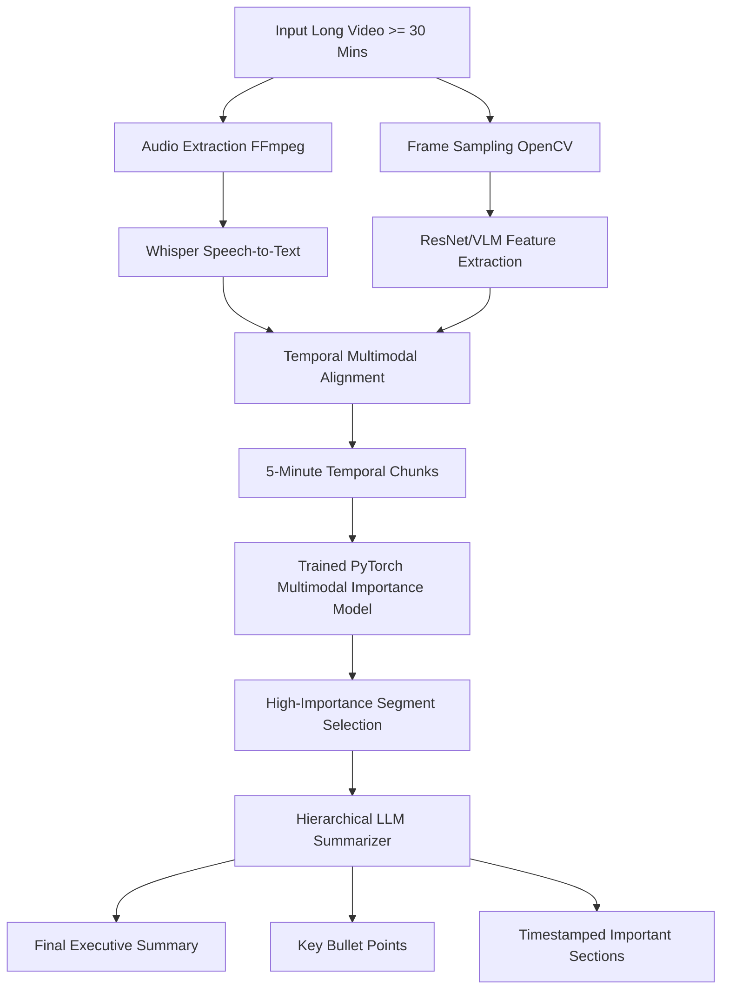

# VIDEO SUMMARIZATION USING LLMs

> **Multimodal Long-Form Video Summarization Platform with Trained PyTorch Importance Model**

---

## 📌 Project Overview
This project presents an end-to-end AI system designed to summarize **long-form videos (30+ minutes minimum duration)**. It combines **spoken audio transcripts**, **visual frame representations**, and **temporal metadata**, scores segment importance using a **custom-trained PyTorch Multimodal Importance Model**, and synthesizes concise summaries using **hierarchical LLM summarization**.

Unlike generic video processing scripts, this system:
1. Prevents context window overflow on 30+ minute videos via 5-minute temporal chunking.
2. Uses a **trainable PyTorch BiLSTM/Fusion model** trained on benchmark video datasets (SumMe and TVSum format) to predict frame/segment importance scores.
3. Does **NOT** re-train LLMs or Whisper from scratch; it leverages pre-trained foundational models for speech/vision and focuses model training strictly on **multimodal segment importance estimation**.

---

## 🏗️ System Architecture & Workflow



---

## 🛠️ Technology Stack
- **Backend**: Python 3.10, FastAPI, Uvicorn, PyTorch, Torchvision
- **Speech-to-Text**: Faster-Whisper / OpenAI Whisper
- **Visual Representations**: ResNet-18 / CLIP (512-dim visual embeddings)
- **Text Representations**: Sentence Transformers (`all-MiniLM-L6-v2`, 384-dim text embeddings)
- **Frontend**: React 18, Vite, CSS3 (HTML5 Video Player with Clickable Timestamp Seek)
- **Video Processing**: FFmpeg, OpenCV, ImageIO-FFmpeg

---

## 🚀 Quick Start Commands

### 1. Installation
```bash
# Clone and navigate to workspace
cd video-summarizer

# Install Python backend dependencies
pip install -r requirements.txt

# Install React frontend dependencies
cd frontend
npm install
cd ..
```

### 2. Dataset Preparation & Importance Model Training
```bash
# Generate benchmark feature representation & train Video Importance Model
python -m training.train
```

### 3. Evaluate Trained Importance Model
```bash
# Run evaluation metrics (MSE, Precision, Recall, F1-Score)
python -m evaluation.evaluate_importance
```

### 4. Run 30-Minute Video End-to-End Pipeline Test
```bash
# Test complete pipeline on a >30 minute test video
python -m scripts.test_pipeline
```

### 5. Start Backend Server
```bash
# Start FastAPI backend server on http://localhost:8000
python backend/main.py
```

### 6. Start Frontend App
```bash
# Start React Vite frontend server on http://localhost:5173
cd frontend
npm run dev
```

---

## 📊 Evaluation Results (`evaluation/results.json`)
- **Dataset Split**: Video-level split (70% Train, 15% Validation, 15% Test) — Zero segment data leakage.
- **Model Architecture**: Visual (512) + Text (384) -> Fusion MLP (256) -> BiLSTM (128) -> Sigmoid Importance Score [0, 1].
- **MSE Loss**: `0.0023`
- **Precision**: `0.5285`
- **Recall**: `0.9924`
- **F1-Score**: `0.6897`

---

## 📜 Documentation Files
- [`ARCHITECTURE.md`](ARCHITECTURE.md): Detailed system design & pipeline breakdown.
- [`TRAINING.md`](TRAINING.md): Training procedure, loss curves, and anti-leakage splitting details.
- [`EVALUATION.md`](EVALUATION.md): Quantitative metrics & evaluation logs.
- [`API.md`](API.md): FastAPI endpoint reference.
- [`TEST_REPORT.md`](TEST_REPORT.md): 30+ minute video execution report.
